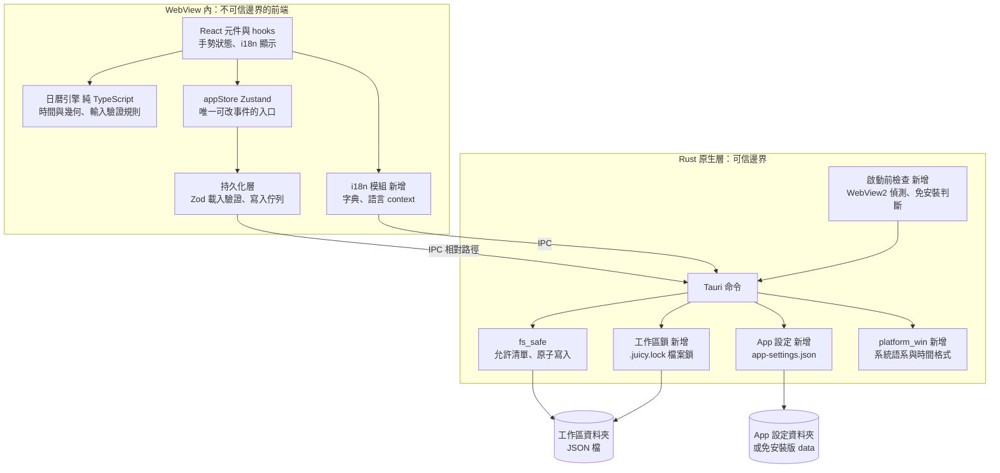

# 04 SAD — Juicy Calendar

| 項目 | 內容 |
|---|---|
| 版本／狀態 | v0.1 **草稿**（待專案擁有者審查） |
| 審查者 | 專案擁有者 |
| 日期 | 2026-11-04 |
| 上游 | `docs/02-prd.md`、`docs/03-srs.md`（皆已確認）、`ARCHITECTURE.md`（現有架構，demo 作者描述）、`AGENTS.md` |
| 技術棧 | 已固定：Tauri 2（Rust）＋ React 19 ＋ TypeScript ＋ Zustand ＋ Zod，資料為工作區資料夾內的 JSON 檔，無資料庫（`CLAUDE.md` 第 8 節） |
| 本文件做的決定 | 2026-11-04 專案擁有者已核准：語言設定位置（ADR-02）、單一寫入者採阻擋開啟（ADR-01）、多語系自行實作不加套件（ADR-03）、Windows 原生呼叫只用 Rust 直接宣告不加套件（ADR-04）。其餘為我的提案，待審查 |

## 情境與品質驅動

**最重要的使用者路徑**（對應 `diagrams/` 三張圖）：放球建立區塊、調整與命名、開啟工作區（還原與壞檔處理）。

**資料敏感性**：資料是使用者個人的時間安排，沒有帳號、金鑰或網路傳輸。最壞的故障是**使用者的資料被覆寫、損毀或遺失**，所以設計的第一優先是「拒絕時不產生副作用」與「寫入不損毀」，而不是效能。

**主要品質要求**（SRS）：NFR-02 原子寫入、NFR-03 離線與不對外連線（拆成 a／b／c 三項，c 尚未達成，見 SRS）、NFR-04 舊工作區可升級、NFR-05 Windows 可安裝、NFR-07 排版動態調整；NFR-01 測試可重複與 NFR-06 效能待量測。

**環境**：開發在 Windows 11（Node 24、Rust 1.99.1）；預期部署為使用者本機的 Windows 10 1803 64 位元以上，兩種形式：NSIS 安裝檔、免安裝 .zip。**不適用**：伺服器、雲端、CI 部署、自動更新、程式碼簽章（NG-05）；若將來公開發布需補：授權條款（D-01）、發布流程、簽章策略。

## 元件與資料流

**信任邊界有三條**：
1. **WebView 與 Rust 之間（IPC）**：前端不可信。前端只能傳工作區內的相對路徑，Rust 逐一比對允許清單、拒絕 `..` 與跳出工作區的符號連結（既有，`AGENTS.md` 規則 5）。鎖檔、App 設定檔**不進**前端的路徑允許清單，前端只能透過專用命令間接使用。
2. **磁碟上的檔案**：使用者可能手動改過或檔案損毀，一律視為不可信輸入。載入時由前端的 Zod 驗證（R-5）；Rust 只負責路徑安全與原子寫入，不理解行事曆內容。
3. **跨行程**：多個 App 行程可能指向同一個資料夾。以作業系統的檔案鎖保證同時只有一個寫入者。

**輸入在哪裡驗證**：指標位置與面板輸入由引擎的純函式驗證，不合法就回傳「拒絕」，事件不改變；通過後由 `appStore` 的 action 改狀態；持久化層比對差異後排入佇列，由 Rust 原子寫入。載入時方向相反：Rust 讀出文字，前端 Zod 驗證，壞檔略過並留下「檔案名稱與原因代碼」，介面依語言顯示通知。

**失敗怎麼回到使用者**：拒絕輸入 → 欄位還原；寫入失敗 → 變更留在佇列重試（現有行為）；開啟失敗 → 歡迎畫面顯示依語言翻譯的原因；第二個視窗被擋 → 顯示說明。Rust 回傳的是**錯誤代碼**，不是英文句子，由前端翻譯。

| 元件 | 責任／擁有資料 | 失敗時怎麼處理 |
|---|---|---|
| React 元件與 hooks | 手勢、畫面、命名編輯（FR-01、02、04）；手勢暫存狀態，結束時一次提交 | 手勢被取消就丟棄暫存，不碰 store |
| 日曆引擎 | 時間換算、長度範圍、輸入驗證規則（FR-01～03，R-1～R-3）；無狀態 | 回傳「拒絕」或夾住的值，不拋例外 |
| appStore | 事件、模板、選取、復原歷史；唯一改事件的入口 | 找不到物件就忽略 |
| 持久化層 | 載入驗證、差異比對、寫入佇列（FR-05、06，R-4、R-5） | 壞檔略過並記錄；寫入失敗留佇列重試 |
| i18n 模組（新） | 兩種語言字典、目前語言、時間格式（FR-09、10） | 缺字串時顯示英文並在開發與測試時報錯 |
| Rust 命令層 | 工作區根目錄狀態、開啟／還原／關閉（FR-05、07） | 回傳錯誤代碼，不 panic |
| fs_safe | 路徑允許清單、原子寫入（NFR-02） | 拒絕路徑；寫入失敗清掉暫存檔 |
| 工作區鎖（新） | 單一寫入者（FR-07） | 取不到鎖回傳 `WORKSPACE_LOCKED`，且不寫入任何檔案 |
| App 設定（新） | 語言設定檔（FR-09、11） | 讀不到或損毀就當作「尚未設定」，改用系統語言偵測 |
| platform_win（新） | 系統語系與 12/24 小時設定（FR-09、10） | 取不到回傳 null，前端退回瀏覽器的 Intl |
| 啟動前檢查（新） | 缺少 WebView2 的說明、免安裝模式判斷（FR-08、11，U-12） | 缺少時顯示原生說明視窗後結束，不進入 Tauri 啟動 |
| 打包 | NSIS 安裝檔與免安裝 .zip（FR-08、11） | 見下方風險 |

## 重要決策與取捨

### ADR-01｜單一寫入者：作業系統檔案鎖（專案擁有者已核准，採阻擋開啟）

決定：在工作區資料夾放一個隱藏鎖檔 `.juicy.lock`（內容為空），App 開啟工作區時對它取得**獨占檔案鎖**（Rust 標準函式庫 `File::try_lock`，不需新套件），並持有到關閉或離開。第二個視窗取不到鎖，就被**阻擋開啟**並顯示說明。

實驗證據（2026-11-04，Windows 11、Rust 1.99.1，隔離小程式）：①持有者鎖住後，另一個行程可開啟同一檔案並偵測到「已被鎖住」；②持有者被強制結束（`taskkill /F`）後，另一個行程立刻取得鎖。第 2 點正好滿足 U-05，且不需要檢查行程編號。

考慮過：①寫入含行程編號的鎖檔：行程異常結束後留下過期鎖檔，需判斷行程是否還活著，要額外邏輯或新套件。②`tauri-plugin-single-instance`：新套件，且只擋同一個 App 的重複啟動，擋不住免安裝版與安裝版並存、或兩份不同路徑的副本指向同一資料夾。③唯讀開啟：所有編輯操作都要能停用，介面改動大，而目前沒有「只想看」的需求。

代價與限制：鎖檔是使用者資料夾裡的一個空檔案；檔案鎖在網路磁碟與雲端同步資料夾上的行為**不保證可靠**（Brief 風險 R-01、假設 A-04，未實測）。可逆性：高，移除鎖檔邏輯不影響資料格式。

影響與驗證：FR-07、U-05、NFR-02。Rust 測試：鎖被持有時第二次開啟失敗且鎖檔的大小與修改時間不變；釋放後可再開啟。

### ADR-02｜語言設定存在 App 設定資料夾（專案擁有者已核准）

決定：安裝版把語言設定存在 `app_config_dir` 下的 `app-settings.json`，與現有的 `last-workspace.txt` 同一處（Windows 為 `%APPDATA%\app.juicycalendar.timeblock\`）。免安裝版固定存在執行檔旁 `data` 資料夾內，才能整個資料夾帶走。

考慮過：使用者的「文件」資料夾（你先前的想法）：需要新增一個 Rust 可存取的位置；許多 Windows 使用者的「文件」會被 OneDrive 同步，兩台電腦的語言設定可能互相覆蓋；且 App 層級的狀態會分散在兩處。已向你說明，你選擇 App 設定資料夾。

影響與驗證：FR-09、FR-11、SRS U-01。前端不接觸該路徑，只呼叫專用命令。

### ADR-03｜多語系自行實作，不加套件（專案擁有者已核准）

決定：一份有型別的字典（兩種語言以 TypeScript 的 `satisfies` 保證鍵值完全相同）加一個 React context。日期的星期與月份用已有的 `date-fns` 內建 `zh-TW` 語系。

考慮過：`i18next` ＋ `react-i18next`：功能完整，但新增兩個套件，對兩種語言、約 30 到 40 個文字來說偏重（文字量為我用 grep 的粗估，實作時需正式盤點）。

代價：沒有內建的複數與語系偵測，目前不需要。可逆性：高，字典的鍵可直接搬到函式庫。

影響與驗證：FR-09、NFR-07。測試：兩種語言鍵值一致；每個鍵在 30 個全形字名稱下不溢出（NFR-07，視覺檢查）。

### ADR-04｜Windows 原生呼叫只用 Rust 直接宣告，不加套件（專案擁有者已核准）

決定：新增一個隔離的 `platform_win` 模組（僅 Windows 編譯，其他平台回傳 null），直接宣告需要的 Windows 函式：`GetLocaleInfoEx`（系統語系與 12/24 小時）、讀登錄值（偵測 WebView2）、`MessageBoxW`（說明視窗）。unsafe 程式只在這個模組內，並附測試。

實驗證據（2026-11-04）：
- **時間格式**：直接呼叫 `GetLocaleInfoEx` 在這台電腦回傳 `tt hh:mm` 與 12 小時；Edge（WebView2 同為 Chromium）的 Intl 也是 12 小時，兩者目前一致。**使用者自訂格式與語系預設不同時，Intl 是否跟上，未實測**（要改系統設定，我沒動），所以設計上以 Rust 回報的值為準，Intl 只當備援。
- **缺少 WebView2**：用官方環境變數指向空資料夾模擬，App 在 Tauri 啟動後的事件迴圈裡 panic 結束（`Could not find the webview runtime`，結束碼 101），正式版又沒有主控台，使用者**完全看不到任何訊息**。這個 panic 發生在 `Builder::run` 內部，無法用 `Result` 攔截，所以必須在啟動 Tauri 之前自己偵測。偵測用微軟文件記載的登錄值（`EdgeUpdate\Clients\{F3017226-…}` 的 `pv`），在這台電腦存在且為 156.0.4314.58。

考慮過：新增 `windows-sys` 套件（少寫 unsafe 宣告，但多一個依賴）；從 WebView 的 Intl 取格式（不保證跟上自訂設定）。

代價：一小段 unsafe；只偵測「已安裝的 Evergreen 執行階段」，不處理固定版本執行階段。

影響與驗證：FR-08、FR-10、U-08、U-12。免安裝版缺少 WebView2 時，顯示說明視窗並**引導使用者用瀏覽器自行下載**，App 本身不連網（維持 NFR-03）。

### ADR-05｜免安裝版以 `portable.flag` 判斷（專案擁有者已核准，2026-11-05，S-01）

決定：免安裝 .zip 內含執行檔、一個空的 `portable.flag`、一個空的 `data` 資料夾與說明檔。App 啟動時若執行檔旁有 `portable.flag`，就是免安裝模式：**啟動時一律開啟**執行檔旁的 `data`、不使用 `last-workspace.txt`；App 設定**始終**存在執行檔旁的 `data`，不跟著手動切換的工作區移動。仍可手動切換工作區，但下次啟動回到 `data`。安裝版沒有此檔案，行為不變。

核准時的附帶條件（專案擁有者）：①`data` 無法建立或寫入時，**顯示明確錯誤**，不自動改存使用者目錄（否則使用者以為整包帶走，資料卻留在原電腦）。②手動切到外部工作區後，那份資料**不包含**在「整包帶走」的承諾內，說明檔要寫清楚；下次啟動仍回到內建的 `data`。③WebView2 快取位置另外驗證，不阻塞模式判斷。

考慮過：①只看 `data` 是否存在：安裝版若被使用者放了同名資料夾會誤判。②另外編譯一份免安裝專用的程式：多一套建置，兩份行為可能分歧。③命令列參數：雙擊執行時無法帶參數。

代價：免安裝版仍會在 `%LOCALAPPDATA%` 留下 WebView2 的快取，「整包帶走」指的是**使用者資料**；是否能把快取也指到 `data`，需另外驗證 Tauri 的 `data_directory` 設定（**未驗證**）。

影響與驗證：FR-11、SRS R-8。免安裝模式的判斷函式以「執行檔所在目錄」為參數，測試時傳入暫存資料夾。

## 運作、風險與未決

**備份與恢復**：資料是使用者自己的資料夾，由使用者備份；App 保證寫入原子，壞檔不被改寫（`settings.json` 損毀會另存 `settings.corrupt.json`）。**可觀察錯誤**：介面通知（有錯誤代碼對應的翻譯）；沒有遙測，也不寫日誌檔。**回退**：工作區格式版本維持 2（見 SDS），舊版 App 仍能開新版寫過的工作區；載入規則變嚴，由新版略過超限檔案。

**風險**（含尚未驗證的項目）：

| 風險 | 影響 | 因應 |
|---|---|---|
| 檔案鎖在網路磁碟與雲端同步資料夾可能不可靠 | 兩個視窗可能同時寫入 | README 建議資料夾放本機非同步位置；未實測，列為測試計畫的人工項目 |
| 原生 `<input type="time">` 的顯示格式跟隨 WebView 的語系，App 其餘時間跟隨 Windows 設定；使用者自訂了與語系預設不同的格式時，兩者可能不一致 | 違反 AC-03.3 的「所有時間一致」 | 預設設定下兩者一致（上方實驗）；自訂格式的情況列為人工測試與已知限制，不自製時間輸入控制項（SRS U-02 決定只跟隨系統） |
| `tauri build` 打 NSIS 時需下載 NSIS 工具，我預期會寫到使用者資料夾（C 槽，路徑與是否可改位置**未驗證**） | 違反「新工具優先放 D 槽」 | 打包前先查證並向你說明，再執行；不默默寫入 C 槽（`CLAUDE.md` 3.3） |
| WebView2 安裝策略依 Tauri 文件為 `downloadBootstrapper`，**未在本機驗證**；Windows 10 1803 上能否執行**未驗證** | NFR-05 | 在乾淨環境人工驗證；找不到 1803 環境就標「未驗證」 |
| 新增 unsafe 程式 | 記憶體安全風險 | 隔離在單一模組、只宣告 3 個函式、附測試 |
| 免安裝版缺少 WebView2 時沒有安裝程式可補 | 使用者無法啟動 | 啟動前檢查顯示說明（ADR-04） |

**待決**：

| ID | 問題 | 決策人 | 期限 |
|---|---|---|---|
| Q-05 | radial hover 效果的樣式 | 專案擁有者 | **已決（2026-11-05）**，見 PRD AC-01.4 |
| D-01 | 開源授權條款 | 專案擁有者 | 首次公開發布前 |
| D-06 | 深色模式開發時程 | 專案擁有者 | 首次交付之後 |
| S-01 | ADR-05（`portable.flag`）是否同意 | 專案擁有者 | **已決定（2026-11-05）**：同意，附三項條件，見 ADR-05 |
| S-02 | 打包 NSIS 前的 C 槽寫入確認 | 專案擁有者 | **已決定（2026-11-05）**：選 A，設 `bundle.useLocalToolsDir: true` 讓工具放 `src-tauri/target/.tauri/`；建置前仍須再確認，建置後檢查 `%LOCALAPPDATA%/tauri` 是否出現 |

> 審查重點：每個元件有責任；信任與資料邊界清楚；關鍵失敗模式有對策；取捨和需求相容；沒有聲稱未驗證的上線能力（上表已標出未驗證項目）。
