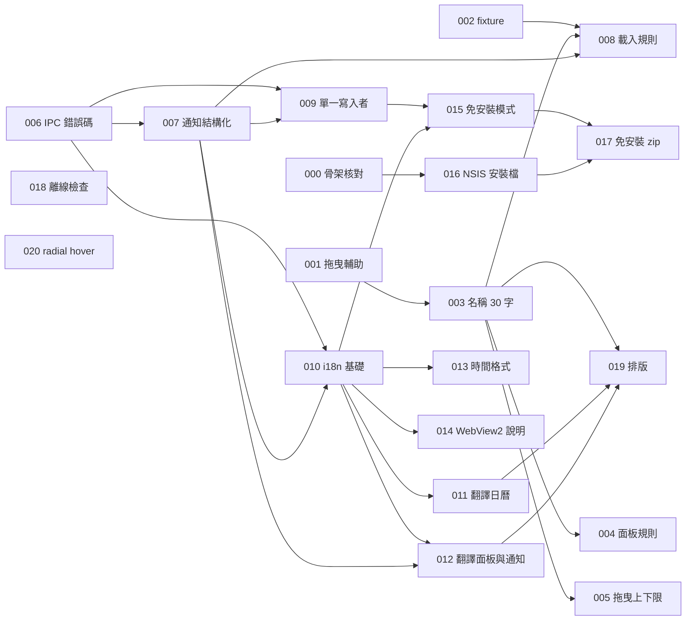

# issues — 工作票

來源：`docs/05-sds.md`、`docs/06-test-plan.md`（2026-11-04 由專案擁有者確認拆法）。每張票一個檔，編號依依賴順序。尚未設定 issue tracker（`/setup-matt-pocock-skills` 未執行），所以用本資料夾；若之後改用 tracker，再整批搬移。

## 共同規則（每張票都適用）

1. **每張票另開新對話**，重新指定該票與它引用的規格，不要靠上一個對話的記憶。
2. 開工先讀：`AGENTS.md`、`CLAUDE.md`、`CODING_STANDARD.md`、票上列的規格段落、`docs/LESSONS.md`，再核對實際的工作樹狀態。
3. **一次一個行為，先紅後綠**：先寫測試，看到「原因正確」的失敗並貼出輸出，**停下來讓專案擁有者確認**，再做綠燈。每個測試標註 TC 與需求編號。不得刪除、跳過或放寬測試；測試與規格衝突時，先提出證據、由人確認再改。
4. 預期值來自規格與人工算例，不得呼叫實作程式當答案；每個拒絕案例同時核對「錯誤」與「資料沒變」。
5. 不新增套件（`AGENTS.md`）；不開啟使用者的真實工作區做測試；測試暫存建議在程序內把 `TEMP` 設為 `D:\DevCache\tmp`。
6. 環境：Rust 不在 PATH，執行前在該程序設 `RUSTUP_HOME=D:\DevTools\rust\rustup`、`CARGO_HOME=D:\DevTools\rust\cargo`，並把 `D:\DevTools\rust\cargo\bin` 加進 PATH；Playwright 的瀏覽器路徑由使用者環境變數 `PLAYWRIGHT_BROWSERS_PATH` 指向 `D:\DevTools\playwright-browsers`（新開的終端機才吃得到）。
7. **完成時**：跑相關測試與完整檢查（`npm run typecheck`、`npm run lint`、`npm test`，涉及 Rust 加 `npm run test:rust`，涉及畫面加 `npm run test:e2e`）；回填 `docs/06-test-plan.md` 的追溯表（實際指令、通過與失敗數、日期）；更新 `docs/HANDOFF.md`；新踩的坑或規格歧義補進 `docs/LESSONS.md`。區分「已設計／已實作／已執行通過」，未驗證的項目明確列出。
8. **不自動 commit 或 push**。改動範圍以票為限；發現需要改票以外的檔案，先問。
9. 狀態標「未就緒」的票，**開工前先確認它列出的決定已經做出**；決定改變了票的前提，就先改寫票，不要硬做。

## 索引

大小：S 一個對話輕鬆完成；M 一個對話內完成；L 偏大但無法拆得更小而仍可單獨驗證。

| # | 票 | 大小 | Blocked by | 狀態 |
|---|---|---|---|---|
| 000 | [骨架核對：Windows 桌面版啟動與 health 檢查](000-skeleton-windows-check.md) | M | 無 | 可開始 |
| 001 | [修好拖曳測試輔助函式](001-fix-drag-helper.md) | S | 無 | 可開始 |
| 002 | [測試 fixture 建構器與重開後一致](002-fixtures-and-reopen.md) | S | 無 | 可開始 |
| 003 | [名稱不得超過 30 字，常數集中](003-name-limit-30.md) | M | 001 | 等待前置票 |
| 004 | [面板時間與持續分鐘的新規則](004-panel-time-rules.md) | M | 003 | 等待前置票 |
| 004a | [TC-02 間歇失敗（Escape 後預覽殘留）](004a-tc02-escape-ghost.md) | S | 無 | 完成（插入任務） |
| 005 | [拖曳邊緣的 1 分鐘到 7 天上下限](005-resize-bounds.md) | S | 003 | 完成 |
| 006 | [IPC 錯誤改為代碼與診斷文字](006-ipc-error-codes.md) | M | 無 | 完成 |
| 007 | [通知與開啟錯誤以代碼呈現](007-structured-notices.md) | M | 006 | 等待前置票 |
| 008 | [載入規則變嚴：過長事件與過長名稱視為壞檔](008-load-rules-stricter.md) | M | 002、003、007 | 完成 |
| 009 | [單一寫入者：第二個視窗被擋](009-single-writer-lock.md) | L | 006、007 | 完成（人工驗收未做） |
| 010 | [多語系基礎：語言選單、偵測與設定持久](010-i18n-foundation.md) | L | 006、007 | 等待前置票 |
| 011 | [翻譯日曆與工具列](011-translate-calendar.md) | M | 010 | 等待前置票 |
| 012 | [翻譯面板、模板編輯器、通知與錯誤](012-translate-panel-notices.md) | M | 007、010 | 等待前置票 |
| 013 | [時間格式跟隨 Windows](013-time-format-windows.md) | M | 010 | 等待前置票 |
| 014 | [缺少 WebView2 時顯示說明](014-webview2-preflight.md) | M | 010 | 等待前置票 |
| 015 | [免安裝模式](015-portable-mode.md) | M | 009、010，**S-01 決定** | **未就緒** |
| 016 | [NSIS 安裝檔與 README](016-nsis-installer.md) | M | 000，**S-02 決定** | **未就緒** |
| 017 | [免安裝 .zip 組裝腳本](017-portable-zip.md) | S | 015、016 | 等待前置票 |
| 018 | [離線靜態檢查](018-offline-static-check.md) | S | 無 | 可開始 |
| 019 | [排版隨內容與視窗調整](019-adaptive-layout.md) | M | 003、011、012 | 等待前置票 |
| 020 | [radial 選單 hover 效果](020-radial-hover-effect.md) | M | **Q-05 決定**、`DESIGN.md` 規則修訂 | **未就緒** |
| 021 | [面板持續時間可用小時＋分鐘或分鐘輸入](021-duration-hours-minutes.md) | S | 004、SRS R-3 修訂 | **未就緒** |
| 022 | [e2e 間歇失敗（overlapping、weekly/daily）](022-e2e-intermittent-failures.md) | S | 無 | 可開始 |

**待專案擁有者決定**：S-01（以 `portable.flag` 判斷免安裝模式，見 `docs/04-sad.md` ADR-05）、S-02（`tauri build` 下載 NSIS 工具的寫入位置，預期在 C 槽，見 SDS 打包契約）、Q-05（radial hover 樣式）。

## 依賴圖

## 建議順序

000／001／002／006（可平行，互不衝突）→ 003 → 004、005、007 → 008、009、010 → 011、012、013、014 → 015、016 → 017 → 019。011、012、013、019 會修改同一批介面檔案，**請依序做，不要同時做**。018 隨時可做。020 等決定。

## 不屬於票的後續步驟

全部票完成後，依 cheatsheet 的 K 卡做交付檢查（`/code-review`、`docs/DELIVERY.md`）；深色模式（Brief G-06）與授權條款（D-01）不在這批票內。
